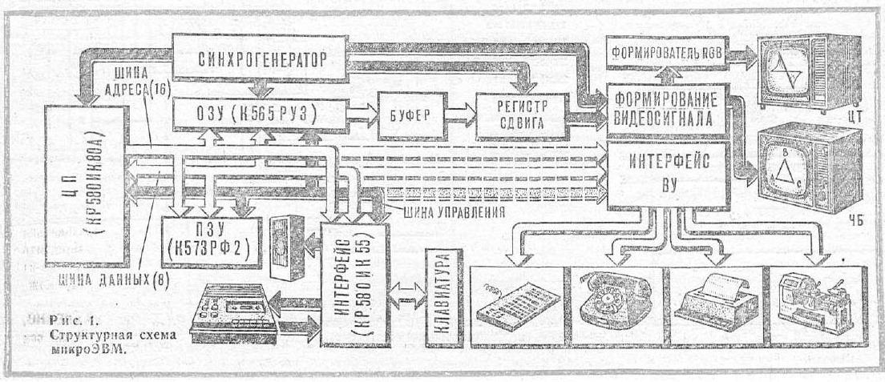
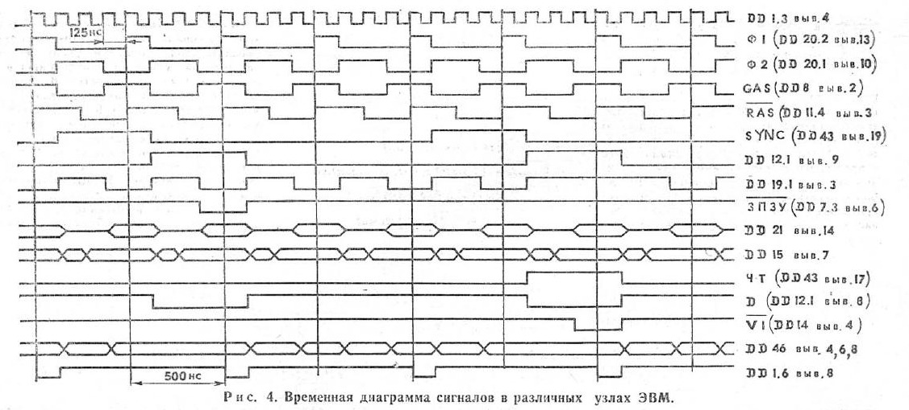

# Архитектурные сведения о «Специалисте»

Источник: статья «Ваш помощник — компьютер», «Моделист-Конструктор», 1987, № 2, печатные страницы 19–22 (PDF-страницы 23–26). Ниже собраны сведения из текста и рис. 1; это не домысливание схемы и не сведения из сторонних эмуляторов.

## Основные узлы

- Центральный процессор: **КР580ИК80А**, тактовая частота 2 МГц.
- ОЗУ: **К565РУ3**, 32/48 Кбайт.
- ПЗУ: **К573РФ2**, 2–12 Кбайт.
- Интерфейс: **КР580ИК55**; интерфейс и внешние устройства адресуются как ячейки памяти.
- Шины: 16-разрядная адресная, 8-разрядная данных и шина управления.
- Тактовый генератор стабилизирован кварцем с резонансной частотой 8 МГц.

## Память и видео

- Экранная область находится в основной памяти ЭВМ; адреса приведены в [карте памяти](memory-map.md).
- Цикл регенерации ОЗУ: 128 мкс.
- Контроллер дисплея может считывать ОЗУ каждые 0,5 мкс при отсутствии обращения процессора.
- Для разрешения конфликтов используется буферный регистр с задержкой 500 нс.
- Период строчной синхронизации: 64 мкс; строчный гасящий импульс: 16 мкс.
- Период кадровой развёртки: 20 мс; кадровый гасящий импульс: 3584 мкс.
- Изображение формируется сдвиговыми регистрами DD47 и DD48; арбитр ОЗУ построен на триггере DD12.1.

## Клавиатура, магнитофон и расширение

- Клавиатура представляет собой матрицу нормально разомкнутых контактов; сканирование, защита от дребезга и формирование кодов реализованы программно.
- Связь с магнитофоном и генерация звука также программные.
- Способ и формат записи на ленту названы идентичными ПК «Микро-80» и «Радио-86РК»; журнал ссылается на «Радио», № 9 за 1983 год.
- При использовании дополнительных БИС серии К580 (ИК55, ИК51, ВИ53) предусмотрено подключение принтера, перфоратора, графопостроителя, АЦП и ЦАП.
- Дешифратор DD51 позволяет подключить дополнительно шесть микросхем К573РФ2 или КР580ИК55; на каждую отводится 2 Кбайта адресного пространства.

## Принципиальная схема

- [Первая часть рис. 3](figures/figure-3-schematic-part-1.jpg), печатная страница 20.
- [Вторая часть рис. 3](figures/figure-3-schematic-part-2.jpg), печатная страница 21.
