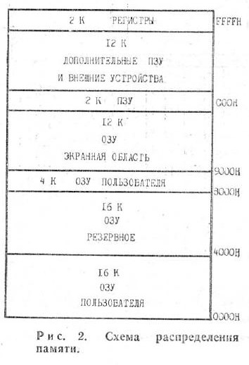

# Карта памяти «Специалиста»

Источник: «Моделист-Конструктор», 1987, № 2, печатная страница 20 (PDF-страница 24), рис. 2. Границы диапазонов вычислены из подписанных на схеме адресов и размеров областей.

| Адреса | Размер | Область по журналу |
| --- | ---: | --- |
| `0000–3FFF` | 16 КиБ | ОЗУ пользователя |
| `4000–7FFF` | 16 КиБ | Резервное ОЗУ |
| `8000–8FFF` | 4 КиБ | ОЗУ пользователя |
| `9000–BFFF` | 12 КиБ | ОЗУ, экранная область |
| `C000–C7FF` | 2 КиБ | ПЗУ |
| `C800–F7FF` | 12 КиБ | Дополнительные ПЗУ и внешние устройства |
| `F800–FFFF` | 2 КиБ | Регистры |

На рисунке использована единица «К»; в таблице она интерпретирована как 1024 байта (КиБ). Слова «резервное ОЗУ» не означают аппаратную недоступность области программам.

Эта таблица отражает только журнальную схему. Разбиение ПЗУ на загрузчик, Monitor 2 и знакогенератор, а также конкретные адреса регистров КР580ВВ55А здесь не указаны и не должны приписываться этому источнику без дополнительных подтверждений.
