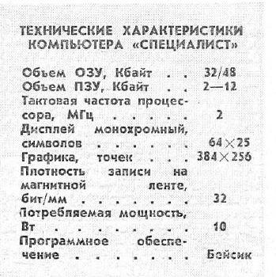

# Технические характеристики «Специалиста»

Источник: «Моделист-Конструктор», 1987, № 2, печатная страница 22 (PDF-страница 26), таблица «Технические характеристики компьютера “Специалист”».

| Параметр | Значение в журнале |
| --- | --- |
| Объём ОЗУ | 32/48 Кбайт |
| Объём ПЗУ | 2–12 Кбайт |
| Тактовая частота процессора | 2 МГц |
| Дисплей | Монохромный |
| Текстовый режим | 64 × 25 символов |
| Графический режим | 384 × 256 точек |
| Плотность записи на магнитной ленте | 32 бит/мм |
| Потребляемая мощность | 10 Вт |
| Программное обеспечение | Бейсик |

