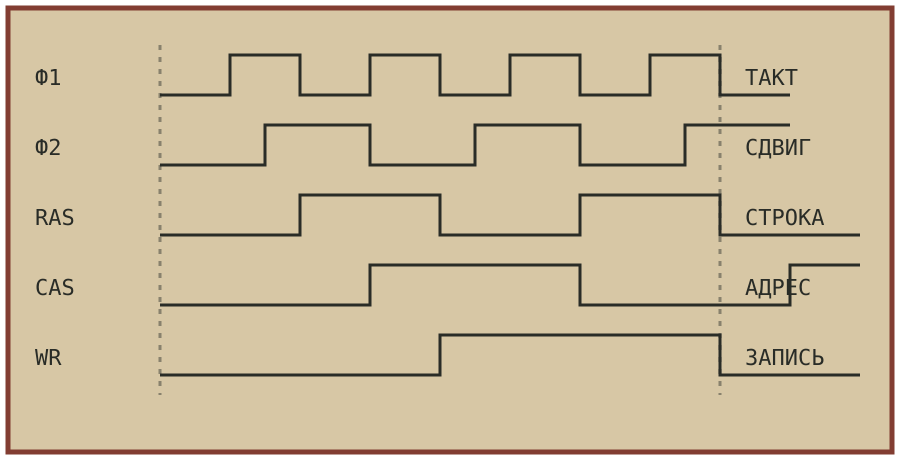

## Не включайте всё сразу

Собранная плата ещё не доказывает работоспособность компьютера. Сначала проверяют сопротивление между питанием и общим проводом, затем напряжение без микросхем, после этого — тактовый сигнал и сброс. Только теперь имеет смысл устанавливать процессор.

Каждый этап должен иметь ожидаемый результат. «Машина не работает» слишком общее описание. «После сброса на адресной шине не появляется начальный адрес» уже указывает направление поиска.

**Проверяемая конструкция начинается с плана проверки.** Запишите порядок испытаний рядом со схемой и не переходите дальше, пока предыдущий сигнал не соответствует расчёту.

## Питание и общий провод

Измерьте напряжение непосредственно на выводах микросхем. Наличие правильного напряжения на блоке питания ещё не означает, что оно дошло до каждого корпуса. Тонкие дорожки, плохая пайка и длинные соединения способны изменить работу всей платы.

Общий провод должен соединять все узлы без неожиданных разрывов. Развязочные конденсаторы устанавливают рядом с микросхемами. Их назначение не декоративное: быстрые переключения создают импульсные токи, и местный запас энергии уменьшает помехи.

## Тактовый сигнал

Тактовый генератор проверяют отдельно от выполнения программы. Осциллограф покажет частоту и форму сигнала, а счётчики — наличие деления. Если генератора нет, процессор останется неподвижен независимо от правильности остальной схемы.

При сравнении измерений учитывайте полосу прибора и способ подключения щупа. Длинный провод может сам стать источником ложных выбросов. Не исправляйте схему по артефакту измерения.



## Сброс и первый адрес

Во время сброса внутренние узлы приходят в известное состояние. После его завершения процессор формирует первый адрес. Именно здесь удобно остановиться и сравнить работу с документацией на выбранный процессор.

Если адрес присутствует, но данные не читаются, проверьте постоянную память и сигналы выбора. Если адрес не появляется, возвращайтесь к питанию, тактам, сбросу и линиям готовности. Не заменяйте исправные микросхемы наугад.

```
питание → такты → сброс → адрес → данные → выполнение
```

## Короткая программа

Первая программа не обязана выводить длинный текст. Достаточно записать известный байт по известному адресу и повторить операцию. По этому действию проверяют дешифратор, шину данных и возможность записи.

Затем можно выполнить бесконечный цикл с изменением одного выхода. Устойчивый сигнал доказывает, что процессор не только начал выполнение, но и продолжает его спустя время. Такой результат проще измерить, чем работу большого монитора.

## Эмулятор и плата

Программная модель помогает подготовить тест до включения аппаратной схемы. Одна и та же короткая программа выполняется сначала в эмуляторе, затем на плате. Сравниваются регистры, память и внешние сигналы.

Расхождение не означает автоматически ошибку платы. Ошибка может быть в эмуляторе, тесте или исходном предположении. Ответ ищут по независимой документации и дополнительному опыту, а не подгоняют одну реализацию под другую.

## Таблица испытаний

| Этап | Наблюдение | Результат |
| --- | --- | --- |
| Питание | напряжение на корпусах | зафиксировано |
| Тактирование | частота и форма | зафиксировано |
| Сброс | начальный адрес | зафиксировано |
| Память | запись и чтение | сравнено |
| Видео | известный рисунок | сравнено |

Законченная таблица превращает единичный запуск в воспроизводимую проверку. Другой конструктор сможет повторить её и понять, какие возможности уже подтверждены, а какие остаются экспериментальными.

Техническое творчество не исключает осторожности. Напротив, именно последовательная проверка даёт свободу менять схему и видеть последствия каждого изменения.

---

**Примечание редакции:** порядок испытаний является учебным. Для конкретной конструкции используйте документацию процессора, памяти и платы, а также правила безопасной работы с электропитанием.
