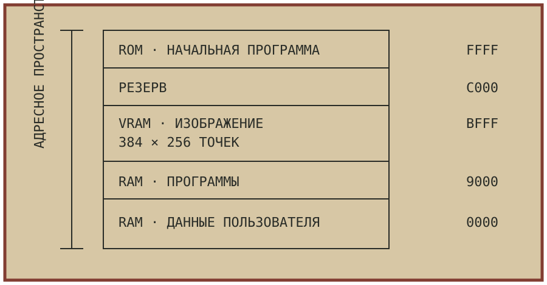

## Компьютер начинается с памяти

Прежде чем собирать домашний компьютер, полезно представить его не набором микросхем, а системой адресов. Каждая ячейка памяти имеет номер. Процессор называет этот номер, передаёт или принимает байт и затем переходит к следующей операции.

У восьмиразрядного процессора шестнадцать адресных линий. Поэтому ему доступно 65 536 адресов — ровно 64 КиБ. В этом пространстве размещаются программы, данные, постоянная память и устройства, которые для процессора выглядят как обычные ячейки.

**Адрес — это ещё не содержимое.** Один и тот же адрес может вести к оперативной памяти, постоянному запоминающему устройству или регистру периферии. Выбор определяет схема дешифрации.

## Карта вместо догадок

Перед монтажом составьте карту памяти. Отметьте начальный и конечный адрес каждой области, назначение и возможность записи. Такая таблица поможет проверить схему ещё до подачи питания.

| Область | Диапазон | Назначение |
| --- | --- | --- |
| RAM | `0000–7FFF` | программы и данные |
| VRAM | `9000–BFFF` | изображение на экране |
| ROM | `C000–CFFF` | начальная программа |
| I/O | `E000–FFFF` | регистры устройств |



Не следует считать приведённую карту универсальной. Разные модели и клоны могут распределять память иначе. В техническом описании всегда указывайте конфигурацию машины и источник сведений.

## Экран в адресном пространстве

В простом домашнем компьютере изображение удобно хранить в общей памяти. Видеосхема периодически читает байты и превращает их в светлые и тёмные точки. Чтобы изменить рисунок, программе достаточно записать новое значение по известному адресу.

При монохромном экране один бит соответствует одной точке. Восемь соседних точек объединяются в байт. Для изображения шириной 384 точки строка занимает 48 байт, а 256 строк — 12 КиБ видеопамяти.

```
384 / 8 = 48 байт в строке
48 × 256 = 12 288 байт изображения
```

Такое устройство экономит отдельную видеопамять, но требует согласования доступа. Процессор и видеосхема не должны мешать друг другу. В простых конструкциях применяют разделение циклов, в более сложных — двухпортовую память или контроллер с арбитражем.

## Постоянная и оперативная память

После сброса процессор начинает выполнение с определённого адреса. Там должна находиться готовая программа: проверка памяти, настройка портов и приглашение пользователю. Её размещают в постоянной памяти, содержимое которой не исчезает после выключения.

Оперативная память хранит рабочие данные. Начальная программа может проверить её, записывая и читая специальные последовательности. Если прочитанное значение отличается от записанного, ищут неисправность в питании, адресных линиях, шине данных или самой микросхеме.

> **Практический совет.** Начинайте проверку с короткой программы и небольшого объёма памяти. Сначала убедитесь, что процессор выполняет несколько команд, затем добавляйте экран, клавиатуру и внешние устройства.

## Три шины одной машины

Адресная шина сообщает, куда идёт обращение. Шина данных переносит байт. Линии управления определяют направление передачи и момент, когда участники обмена должны зафиксировать сигналы.

При чтении память выставляет байт на шину данных. При записи байт выставляет процессор. Если два устройства одновременно попытаются управлять линией, результат станет непредсказуемым, а микросхемы могут повредиться. Корректный дешифратор допускает только одного получателя.

Для первой проверки соберите таблицу ожидаемых сигналов: адрес, чтение или запись, выбранная микросхема, состояние шины данных. Логический анализатор или самодельная диагностическая программа покажет, совпадает ли работа схемы с расчётом.

## Наблюдаемая конструкция

Хорошая самодельная машина должна отвечать на вопросы о собственном состоянии. Выведите несколько важных сигналов на контрольные точки, оставьте место для перемычек и заранее придумайте способ остановить процессор без отключения питания.

Даже небольшая тестовая программа позволяет многое узнать о конструкции. Запись последовательности байтов в видеопамять покажет карту экрана, чтение портов — работу дешифратора, а циклический сигнал на свободном выводе — устойчивость тактовой частоты.

Схема становится понятнее, когда её можно наблюдать в работе. Поэтому технический журнал продолжит тему: в следующих выпусках рассмотрим начальную программу, клавиатуру и сравнение программной модели с аппаратной реализацией.

---

**Источники для дальнейшего чтения:** А. Волков, «Ваш помощник — компьютер», «Моделист-Конструктор», 1987, № 2, с. 19–22; документация проектов `specialist-emulator` и `special20k`. Статья является учебным пересказом, а не воспроизведением оригинальной схемы.
