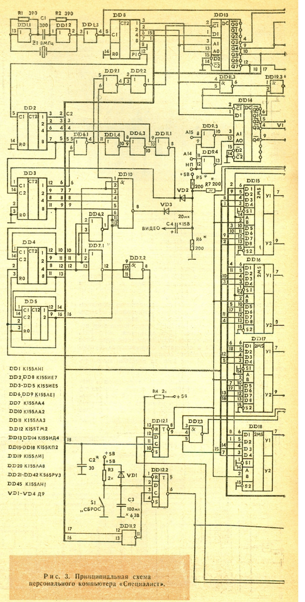
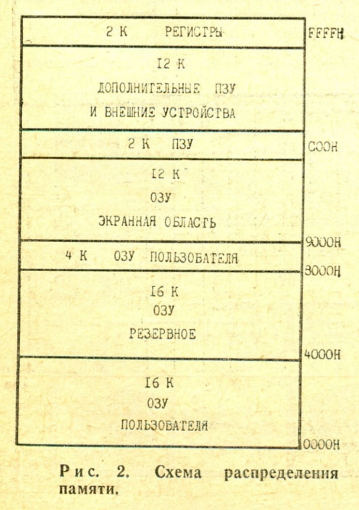
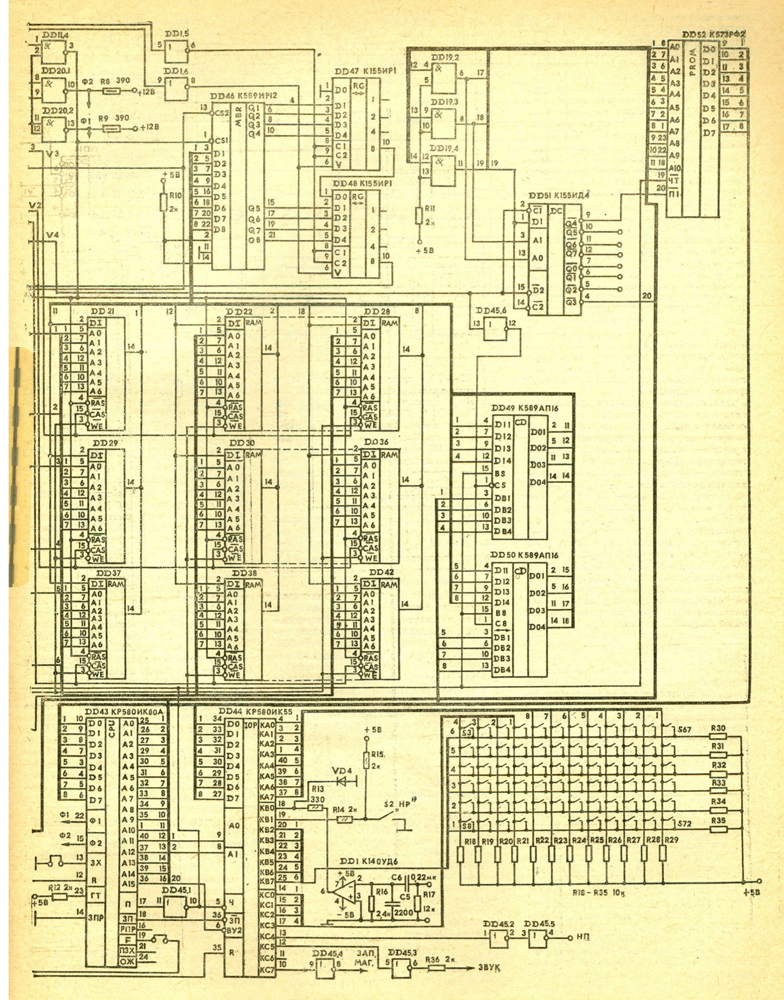
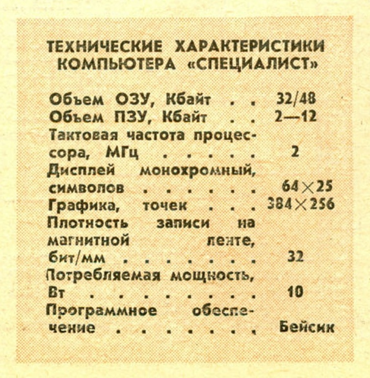

> **Источник:** А. Волков, «Ваш помощник — компьютер», «Моделист-Конструктор», 1987, № 2, с. 19–22.

Среди задач, которые предстоит решить в ходе перестройки общеобразовательной и профессиональной школы, первейшей является компьютерный всеобуч, призванный вооружить учащихся навыками использования современной вычислительной техники. Чтобы освоить `ЭВМ`, необходимо широкое применение вычислительных машин в учебном процессе. Промышленность еще только приступает к массовому выпуску электронно-вычислительной техники. А пока многие энтузиасты строят `ЭВМ` своими силами.

Есть такой энтузиаст и в СПТУ № 4 города Днепродзержинска. Мастер производственного обучения А. Ф. Волков разработал собственную конструкцию персонального компьютера и назвал его «Специалист».

…На небольшом столе свободно разместились портативный телевизор «Сапфир», кассетный магнитофон «Весна», компактная клавиатура управления. Вся электронная «начинка» уместилась на одной печатной плате. Компьютер весит меньше полукилограмма. Для сравнения: `микроЭВМ` «Агат» включает в себя, кроме клавиатуры, еще один блок — солидных размеров. Да и стоимость «Специалиста» гораздо ниже, чем у его промышленного собрата.

Роль дисплея в конструкции Волкова способен выполнять практически любой телевизор, в качестве внешней памяти используется бытовой кассетный магнитофон.

Автор пошел по пути максимального упрощения и отказа от дефицитной электронной «начинки». Компьютер Волкова может обходиться даже без печатной платы. Благодаря использованию дешевых и наиболее доступных микросхем серии `К155` и `КР580` вполне реально в ближайшее время оснастить все школы, ПТУ и техникумы персональными компьютерами.

А каковы возможности «Специалиста»! Несмотря на небольшие размеры и относительную простоту, компьютер умеет многое: решает математические задачи, выполняет инженерные расчеты, неплохо рисует, играет в шахматы и даже музицирует. Обладателю компьютера будет интересно самому составить программы создания оригинальных рисунков для домашней вязки или видеоигр, проверить реакцию игрока в экстремальной ситуации, скажем, дорожного движения, задать ему своеобразный психологический тест на сообразительность. Лучше всего машина знает язык программирования Бейсик, знакомы ей и другие универсальные языки.

«Специалистом» заинтересовались представители Киевского политехнического института, ряда львовских предприятий. Вот мнение, например, ректора Днепропетровского государственного университета академика АН УССР В. Моссаковского:

— Необходимо обязательно и срочно заняться этим компьютером. Это то, что нам нужно. И средним школам, и вузам. Ведь мы готовим преподавателей, которые потом будут обучать школьников компьютерной грамотности.

Сейчас Волков на базе своего компьютера разрабатывает новый тип конструктора. Он предлагает изготовить для юных кибернетиков печатные платы, в которые ребята сами вмонтируют необходимые части логического узла `ЭВМ`. К изготовленному процессору останется подключить только кассетный магнитофон и малогабаритный телевизор — и вычислительная машина готова.

Одноплатный персональный компьютер «Специалист» состоит из центрального процессора (`ЦП`), оперативного (`ОЗУ`) и постоянного (`ПЗУ`) запоминающих устройств, интерфейса для связи с внешними устройствами и клавиатурой и синхрогенератора (рис. 1). Основные узлы взаимодействуют между собой посредством трех шин: 16-разрядной адреса и 8-разрядных данных и управления. `ЦП` `КР580ИК80А` тактируется импульсами частотой 2 МГц, вырабатываемыми синхрогенератором. Память состоит из постоянного запоминающего устройства (`ПЗУ`) объемом 2–12 Кбайт (`К573РФ2`) и оперативного запоминающего устройства (`ОЗУ`) объемом 32/48 Кбайт (`К565РУ3`). Распределение памяти показано на рисунке 2.

Для упрощения конструкции интерфейс (`КР580ИК55`) и внешнее устройство адресуются как ячейки памяти.

Функции синхрогенератора, счетчика регенерации `ОЗУ` и счетчика сканирования дисплея совмещены в одном устройстве, что позволило значительно упростить схему компьютера и обойтись без специальных `БИС`. Цикл регенерации `ОЗУ` — 128 мкс.

Для отображения информации на экране телевизора используется часть основной памяти `ЭВМ`. Это также упрощает конструкцию, но и одновременно создает проблему разрешения конфликта процессора и дисплея при обращении к `ОЗУ`. Когда обращение процессора к `ОЗУ` отсутствует, контроллер дисплея (совокупность элементов, предназначенных для формирования изображения на экране телевизора) может считывать информацию из `ОЗУ` каждые 0,5 мкс. При этом в конце цикла, содержащего 2 обращения к `ОЗУ` по одному и тому же адресу, происходит запись байта информации в регистр сдвига и последующая ее передача на видеовыход.

Если же микропроцессор обращается к `ОЗУ` (для этого необходим интервал 500 нс), тогда в зависимости от того, в каком цикле `ОЗУ` это произошло, информация для отображения в случае необходимости задерживается в буферном регистре на 500 нс с последующей выдачей на экран. Это позволяет сделать работу процессора независимой от дисплея.

## Рис. 2. Схема распределения памяти

| Объём | Область | Адреса |
| --- | --- | --- |
| 2 Кбайт | Регистры | `F800H–FFFFH` |
| 12 Кбайт | Дополнительные `ПЗУ` и внешние устройства | `C800H–F7FFH` |
| 2 Кбайт | `ПЗУ` | `C000H–C7FFH` |
| 12 Кбайт | `ОЗУ`, экранная область | `9000H–BFFFH` |
| 4 Кбайт | `ОЗУ` пользователя | `8000H–8FFFH` |
| 16 Кбайт | Резервное `ОЗУ` | `4000H–7FFFH` |
| 16 Кбайт | `ОЗУ` пользователя | `0000H–3FFFH` |

Для получения полного телевизионного сигнала в формирователе видеосигнала смешиваются импульсы, снимаемые со сдвигового регистра, с импульсами, вырабатываемыми синхрогенератором. Период строчной синхронизации — 64 мкс, длительность строчного гасящего импульса — 16 мкс, период кадровой развертки — 20 мс, длительность кадрового гасящего импульса — 3584 мкс.

Клавиатура состоит из матрицы нормально разомкнутых контактов. Все функции клавиатуры (сканирование матрицы, защита от дребезга, формирование кодов символов и т. д.) реализованы программно. Также программным способом осуществляется связь с магнитофоном и генерация звукового сигнала. Способ и формат записи на магнитную ленту идентичны `ПК` «Микро-80» и «Радио-86РК» (см. «Радио» № 9 за 1983 г.).

При использовании дополнительных периферийных `БИС` серии `К580` (`ИК55`, `ИК51`, `ВИ53`) возможно подключение таких внешних устройств, как принтер (печатающее устройство), перфоратор, графопостроитель, `АЦП`, `ЦАП` и др.

Принципиальная схема компьютера представлена на рисунке 3. Тактовый генератор, стабилизированный кварцем `Z1`, собран на элементах `DD1.1`—`DD1.3`. Резонансная частота кварца 8 МГц. Импульсы с тактового генератора поступают на вход счетчика синхрогенератора (`DD8`, `DD2`—`DD5`), на выходах которого вырабатываются сигналы, используемые для адресации экранной области `ОЗУ` при регенерации изображения. Кроме того, из этих сигналов с помощью логических элементов `DD6.1`, `DD1.4`, `DD6.3`, `DD11.1`, `DD6.2`, `DD7.1`, `DD10` выделяются синхронизирующие и гасящие импульсы. Строчный синхроимпульс с выхода микросхемы `DD11.1` и кадровый синхроимпульс, снимаемый с выхода `DD10`, через диоды `VD2` и `VD3` смешиваются с сигналом изображения, вырабатываемым регистром сдвига `DD47` и `DD48`. Резисторы `R5`—`R7` определяют размах и форму видеосигнала. Кадровый и строчный гасящие импульсы через элементы `DD9.1`, `DD9.2`, `DD13`, `DD1.6` запрещают запись информации в регистры сдвига. Так как на вход `1` микросхемы `DD47` подан уровень `0`, то с появлением гасящих импульсов после восьми сдвигов информации на выходе регистра `DD48` появляется `0`, что соответствует черному цвету.

Узел, состоящий из микросхем `DD13`, `DD20.1`, `DD20.2`, служит для получения тактирующих импульсов `Ф1` и `Ф2` амплитудой 12 В, необходимых для работы микропроцессора, и сигнала `/RAS`, управляющего работой `ОЗУ` и адресных мультиплексоров `DD15`—`DD18`. По заданному фронту сигнала `/RAS` происходит запись младших семи бит адреса в адресный регистр микросхем памяти. Одновременно происходит переключение мультиплексоров, и в `ОЗУ` поступают старшие 7 бит адреса. В зависимости от состояния сигнала `D` (дисплей) на `ОЗУ` поступает код адреса либо от процессора, либо со счетчиков.

Арбитр `ОЗУ` выполнен на триггере `DD12.1`. Этот узел вырабатывает сигнал `D` длительностью 500 нс в том случае, если на выводе `19` `DD43` (микропроцессора) появляется сигнал `SYNC`, предваряющий такт обращения процессора к `ОЗУ`. Если при этом отсутствует сигнал `/ЧТ` (чтение), что неизбежно означает начало цикла записи информации в `ОЗУ`, на выводе `6` `МС` `DD7.3` вырабатывается сигнал `/ЗПЗУ` (запись `ОЗУ`), совпадающий во времени с сигналами `/V1`, `/V2`, `/V3` выборки микросхем `ОЗУ`. Информация из `ОЗУ` поступает на шину данных и обратно через шинные формирователи `DD49`, `DD50`. Направление передачи определяется сигналом `/ЧТ`.

Узел выборки `ОЗУ` состоит из дешифратора `DD14` и элементов `DD11.3`, `DD19.1`. Элементы `DD9.3`, `DD9.4` служат для преобразования адреса при начальном пуске компьютера. Сигнал `«сброс»` обрабатывается триггером `DD12.2`. Длительность сигнала, поступающего с выхода триггера на вход `«сброс»` микропроцессора и интерфейса, кратна периоду кадровой развертки, то есть во много раз больше длительности пяти машинных циклов, необходимых для надежного сброса микропроцессора. Действие сигнала `«сброс»` не нарушает регенерацию `ОЗУ`.

Выборка `ПЗУ` и интерфейсных микросхем обеспечивается дешифратором `DD51`. Возможно подключение дополнительно шести микросхем `К573РФ2` или `КР580ИК55`. При этом на каждую микросхему приходится 2 Кбайта адресного пространства.

Интерфейсный адаптер `КР580ИК55` (`DD44`), помимо обслуживания клавиатуры, выработки звуковых сигналов, которые с вывода `6` `МС` `DD45.3` поступают на `УЗЧ` телевизора, и связи с магнитофоном, обеспечивает работу узла начального пуска.

Формы сигналов на выводах микросхем показаны на временной диаграмме (рис. 4).

## Технические характеристики компьютера «Специалист»

| Параметр | Значение |
| --- | --- |
| Объём `ОЗУ` | 32/48 Кбайт |
| Объём `ПЗУ` | 2–12 Кбайт |
| Тактовая частота процессора | 2 МГц |
| Дисплей | Монохромный |
| Текстовый режим | 64 × 25 символов |
| Графический режим | 384 × 256 точек |
| Плотность записи на магнитной ленте | 32 бит/мм |
| Потребляемая мощность | 10 Вт |
| Программное обеспечение | Бейсик |

А. ВОЛКОВ, г. Днепродзержинск, Днепропетровская обл.

_(Продолжение следует)_
